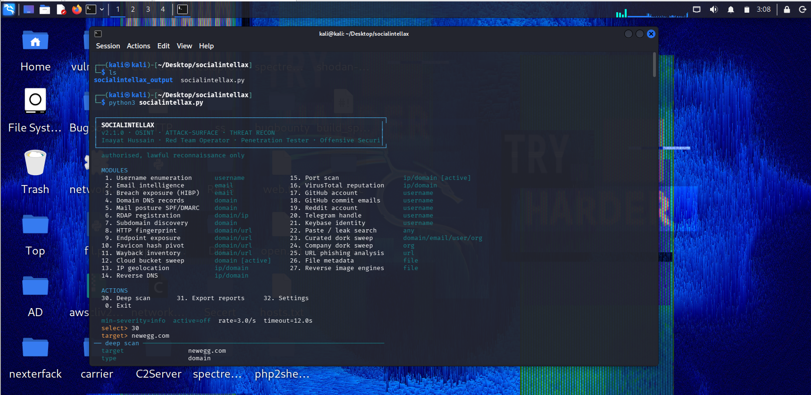
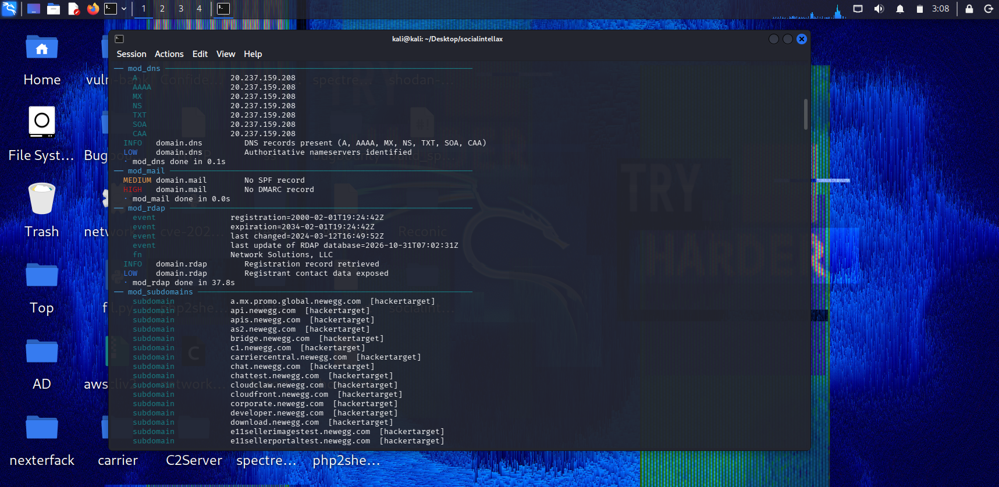
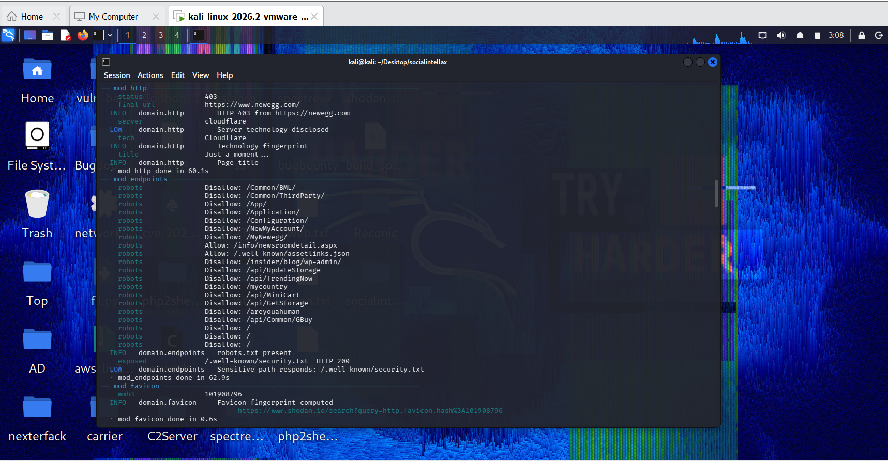
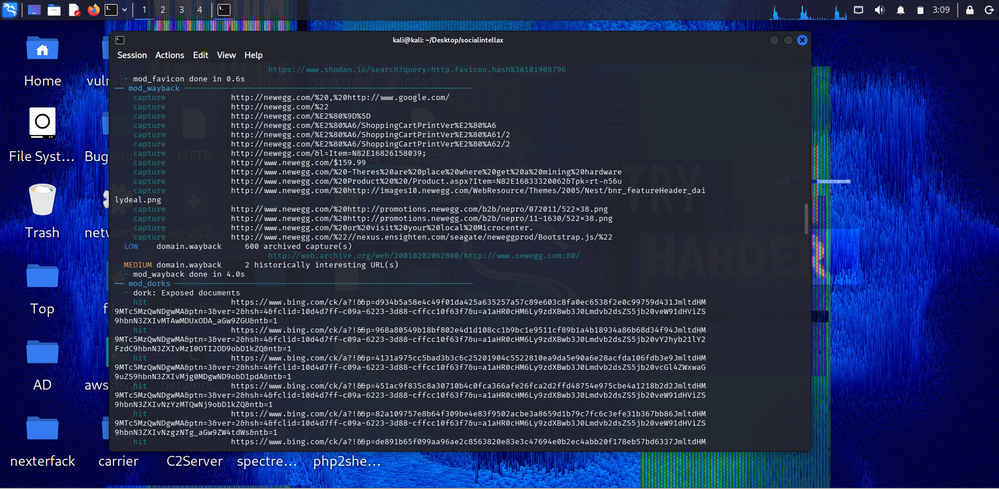
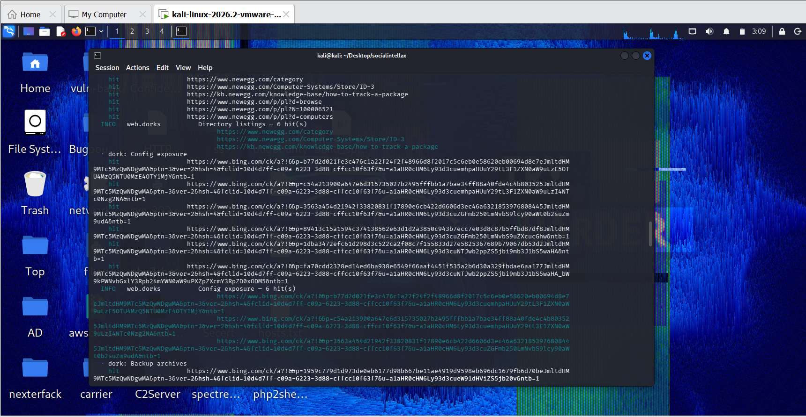
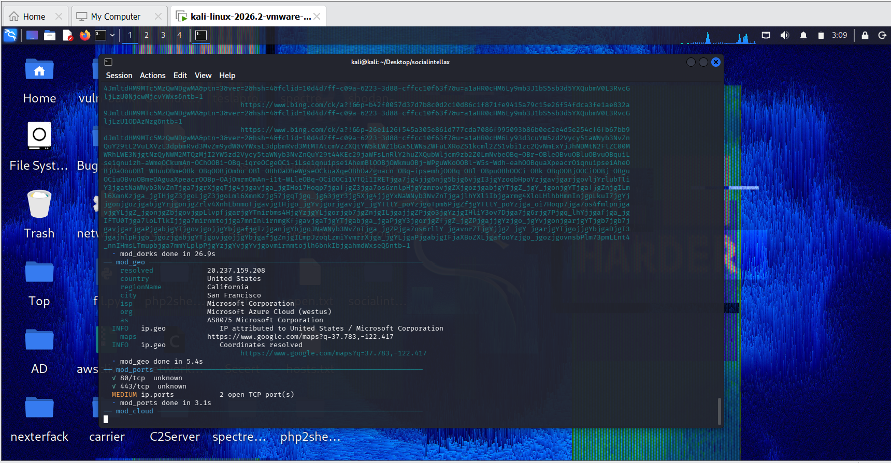

# SocialIntellax

**OSINT · Attack-Surface Intelligence · Threat Reconnaissance**

[](https://www.python.org/)
[](#requirements)
[](LICENSE)
[](#roadmap)
[](#module-reference)

A single-file, menu-driven reconnaissance framework for structured open-source
intelligence collection against usernames, email addresses, domains, IP
addresses, URLs and local files.

Every result is a typed, severity-scored finding with a confidence value and
provenance, streamed to the terminal as it is discovered and written to a
timestamped workspace in JSON, Markdown, CSV and standalone HTML.

Author: **Inayat Hussain** — Red Team Operator, Penetration Tester & Offensive Security Engineer
License: MIT



---

## Contents

- [Design principles](#design-principles)
- [Screenshots](#screenshots)
- [Requirements](#requirements)
- [Installation](#installation)
- [Usage](#usage)
- [Module reference](#module-reference)
- [Deep scan](#deep-scan)
- [Output](#output)
- [Configuration](#configuration)
- [Diagnostics](#diagnostics)
- [Detection logic](#detection-logic)
- [Known limitations](#known-limitations)
- [Legal](#legal)
- [Contributing](#contributing)
- [Roadmap](#roadmap)

---

## Design principles

**Findings, not printouts.** Every result is a `Finding` object carrying
`severity` (info → high), `confidence` (0–100), structured `data` and source
`refs`. Findings are fingerprinted and deduplicated before reporting, so a
module cannot inflate the report with repeats.

**Coverage is explicit.** Modules always emit a result, even when they find
nothing. A blank section in the report means the module ran and came back
empty — not that it silently died.

**Passive by default.** Port scanning and cloud-storage probing are marked
active and gated behind an explicit opt-in, either per-run or globally in
settings.

**Transport discipline.** Per-host token bucket rate limiting, bounded retries
with exponential backoff, an in-session response cache, rotating user agents,
and a TLS-verification fallback so a bad CA store degrades instead of aborting.

**No orchestration required.** One file, one `pip install`, one command. No
daemon, database or agent to keep running.

---

## Screenshots

| | |
|---|---|
| **Module menu** | **Deep scan plan** |
|  |  |

| | |
|---|---|
| **Domain module output** | **Severity-scored findings** |
|  |  |

**Report export and summary**



---

## Requirements

- Python **3.9** or newer
- Linux, macOS or WSL (Parrot OS, Kali Linux and Ubuntu tested)
- Outbound HTTPS, plus TCP/25 and TCP/53 for the active modules

Optional but recommended:

| Package | Purpose when present | Behaviour when absent |
|---|---|---|
| `beautifulsoup4` | Parses search-engine HTML | Falls back to regex extraction |
| `Pillow` | EXIF and GPS recovery | EXIF module reports and skips |

API keys are optional and only raise limits or unlock specific modules. See
[Configuration](#configuration).

---

## Installation

```bash
git clone https://github.com/InayatHussain09/SocialIntellax.git
cd SocialIntellax

python3 -m venv .venv
source .venv/bin/activate

pip install -r requirements.txt
chmod +x SocialIntellaxV2.py

Verify the environment and the network path before the first scan:

bash
./SocialIntellaxV2.py --doctor
--doctor reports interpreter, platform, dependency state, configured keys,
resolver configuration, system clock and a four-layer connectivity probe
(DNS, TCP/443, TCP/53, HTTPS, clock skew). Resolve anything it flags before
scanning; a skewed clock breaks every TLS handshake.

Usage
Interactive menu:

bash
./SocialIntellaxV2.py
Non-interactive:

bash
./SocialIntellaxV2.py example.com                    # deep scan, passive only
./SocialIntellaxV2.py example.com --active           # include active modules
./SocialIntellaxV2.py example.com --min-severity low # suppress info findings
./SocialIntellaxV2.py 203.0.113.10 --active          # IP target
./SocialIntellaxV2.py --list                         # list modules and exit
Flags:

Flag	Effect
--active	Enable active modules for this run
--min-severity	info, low, medium, high — reporting floor
--insecure	Skip TLS verification
--list	Print module table and exit
--doctor	Environment and connectivity check
--no-color	Disable ANSI colour
-V	Version
Menu actions:

Key	Action
1–27	Run a single module against a prompt-issued target
30	Deep scan — plan is derived from the detected target type
31	Re-export the last run in all four formats
32	Settings
Module reference
A marks active modules, off by default.

#	Module	Target	Mode	Purpose
1	identity.profiles	username	passive	Account enumeration across 32 platforms with soft-404 filtering
2	email.lookup	email	passive	Address decomposition, format variants, Gravatar, MX
3	email.breaches	email	passive	Have I Been Pwned exposure (key)
4	domain.dns	domain	passive	A, AAAA, MX, NS, TXT, SOA, CAA
5	domain.mail	domain	passive	SPF and DMARC posture, DKIM selector discovery
6	domain.rdap	domain, ip	passive	Registration record, contacts, expiry
7	domain.subdomains	domain	passive	Passive discovery via crt.sh and hackertarget
8	domain.http	domain, url	passive	Headers, technology fingerprint, disclosure
9	domain.endpoints	domain, url	passive	robots, sitemap, security.txt, .git, .env
10	domain.favicon	domain, url	passive	mmh3 favicon hash for Shodan pivot
11	domain.wayback	domain, url	passive	Wayback snapshot inventory, historic paths
12	domain.cloud	domain, org	A	S3 and Azure blob enumeration
13	ip.geo	ip, domain	passive	Geolocation, ASN, hosting and proxy attribution
14	ip.rdns	ip, domain	passive	PTR record
15	ip.ports	ip, domain	A	TCP connect scan on 31 common service ports
16	ip.reputation	ip, domain	passive	VirusTotal detections (key)
17	github.account	username	passive	Profile, repositories, gists
18	github.activity	username	passive	Author emails leaked in public commits
19	identity.reddit	username	passive	Account age and karma
20	identity.telegram	username	passive	Handle existence
21	identity.keybase	username	passive	Cryptographic identity proofs
22	leaks.pastes	any	passive	psbdmp search plus paste-host dork pivots
23	web.dorks	domain, email, username, org	passive	Curated dork sweep, three engines
24	web.org	org	passive	Organisation dork sweep
25	url.analyze	url	passive	Phishing indicators and redirect chain
26	file.metadata	file	passive	EXIF, GPS, PDF and OOXML property recovery
27	file.reverse-image	file	passive	Reverse-image engine endpoints
Deep scan
Action 30 detects the target type and builds a plan from the modules that
declare it, passive first. If the type has active modules you are asked once
whether to include them; answer y or pre-enable with --active.

Each module runs in isolation. A module that raises is recorded and the scan
continues, with the failure surfaced in the diagnostics block and the report.
A scan never aborts because one source is unreachable.

Output
socialintellax_output/<target>_<YYYYmmdd-HHMMSS>/
├── findings.jsonl      one JSON finding per line
├── report.json         full payload with counts and error logs
├── report.md           coverage table plus findings
├── report.csv          flat tabular export
├── report.html         standalone styled report
└── raw/                raw HTTP bodies and robots.txt captures
Findings are ordered by severity, then module. Every report includes HTTP
success/failure counters and the transport and module error logs, so a thin
result set is explainable rather than ambiguous.

Configuration
Settings (menu 32) are in-session only:

Key	Setting
1	Request timeout
2	Per-host rate limit
3	Minimum severity
4	Active modules on/off
5	Response cache on/off
6–8	HIBP, VirusTotal and GitHub keys
Keys may also be supplied by environment and never touch disk:

bash
export HIBP_API_KEY="..."
export VT_API_KEY="..."
export GITHUB_TOKEN="..."
Key	Unlocks	Notes
HIBP_API_KEY	email.breaches	Paid HIBP tier
VT_API_KEY	ip.reputation	Free tier is rate limited
GITHUB_TOKEN	Higher GitHub API quota	Lifts 60 req/h to 5000 req/h
Without a key the dependent module reports that it skipped, rather than
failing.

Diagnostics
When a run yields zero findings the tool prints a diagnostics block containing
the recorded transport failures and module errors, plus a remediation hint if
every request failed.

Fastest path from a dead scan to a working one:

bash
./SocialIntellaxV2.py --doctor
ip a; ip route
cat /etc/resolv.conf
timedatectl
curl -sI https://example.com
Detection logic
Target classification. URL by scheme, email by pattern, IP by parser,
domain by RFC-shaped label check, file by path existence, otherwise username.
Unrecognised input is rejected before any request.

Soft-404 handling. Platform probes treat a 200 whose body carries
not found / no such user under 8 KB as absent, alongside real 404s. JSON
endpoints returning null or {} are absent too. 429 is reported as rate
limited rather than absent, so throttling is never mistaken for a missing
account.

Severity assignment. Missing DMARC is high because it permits spoofing.
Missing SPF is medium. A disclosed server banner is low. A confirmed account is
medium; a confirmed security-relevant profile is low with a pointer.

Confidence. 95–99 for direct protocol facts, 70–90 for inferred or
third-party claims, 50–65 for search-derived hits.

Known limitations
DNS cache key is URL-only. In this version the response cache does not
include query parameters, so AAAA, MX, NS, TXT, SOA and CAA can
return the cached A answer on a fresh run. Cache keying on
url + params resolves it.
Search modules depend on DuckDuckGo and Bing HTML, which change without
notice; results thin out under rate limiting.
email.smtp needs outbound TCP/25, frequently blocked by ISPs.
LinkedIn, Instagram and X serve login walls, so absence there is weak
evidence.
Wayback, crt.sh and hackertarget are third-party and rate limited.
No Tor integration; .onion targets are out of scope.
Single-threaded module execution in deep scan — slow by design, not
parallelised across modules.
Legal
For lawful, authorised reconnaissance only. Passive collection touches only
public sources; active modules open sockets to the target, so confirm scope
first. Respect third-party rate limits and terms of service.

Contributing
bash
git checkout -b feature/your-feature
# keep modules self-contained, return findings, never print ad hoc
git commit -m "feat: ..."
A module is a method that takes target, calls self.emit(...) for results
and self.note(...) for progress. Register it in MENU, PASSIVE or
ACTIVE, and in the module table above.

Roadmap
 Cache keyed on URL plus parameters
 TLS certificate and SAN inspection
 CNAME takeover detection
 DNSSEC, CAA, MTA-STS, BIMI parsing
 SMTP RCPT TO mailbox verification
 Batch input file and scope regex guard
 --json machine output and --fail-on CI exit codes
 Config persistence and plugin loading
 Coverage matrix in reports
Author
Inayat Hussain
Red Team Operator · Penetration Tester · Offensive Security Engineer

License
MIT — see LICENSE.

## `requirements.txt`

```text
# Core
requests>=2.31
urllib3>=2.0

# Search-engine HTML parsing (regex fallback without it)
beautifulsoup4>=4.12

# Optional: EXIF and GPS recovery for file.metadata
# Pillow>=10.0
